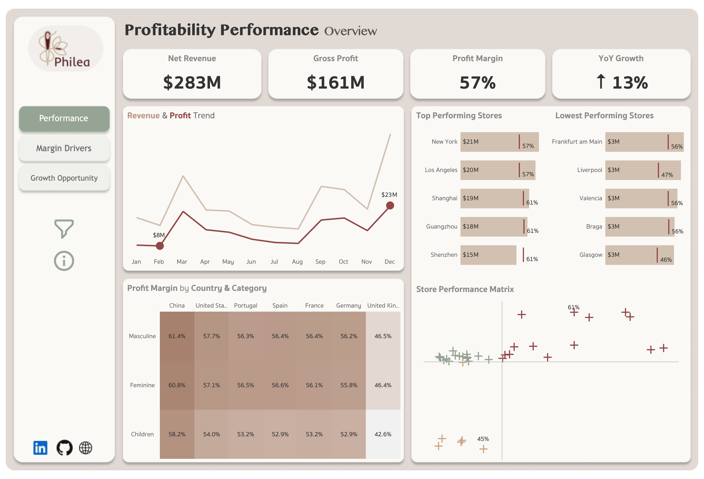
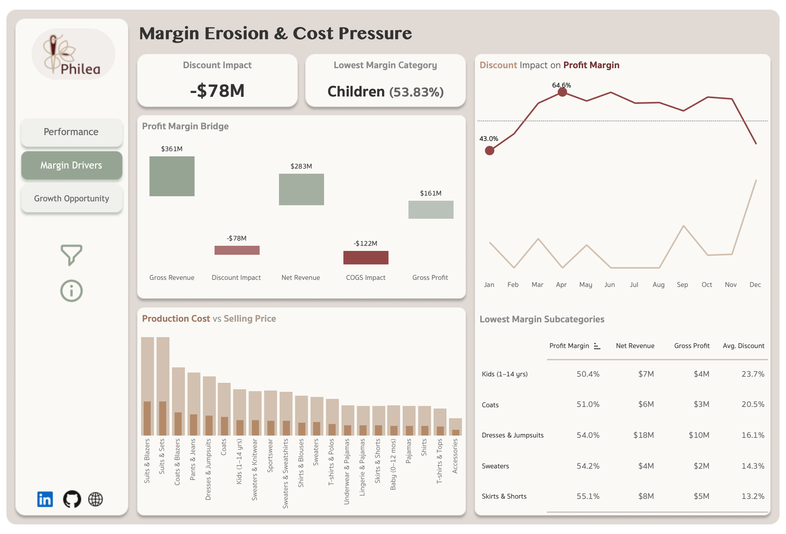
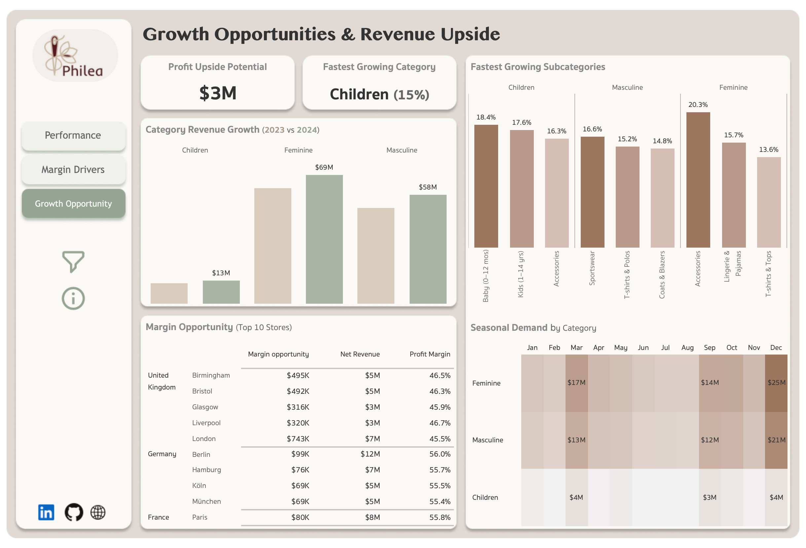

# Business Performance, Margin & Growth Analysis – Philea 

## Business Context
Philea is a multinational fashion retailer operating across 35 stores in 7 countries, offering products across Feminine, Masculine, and Children's categories. Despite strong revenue growth, leadership requires greater visibility into profitability performance, margin pressure, and future growth opportunities across markets and stores.

>**The challenge** is not simply understanding how much revenue the business generates, but identifying where profit is created, where margin is being lost, and where future growth investment should be focused.

### Objectives
1. How is the business performing overall?
2. What factors are reducing profitability?
3. Where are the strongest growth opportunities?

These questions are addressed through three interconnected dashboards.

---

## Executive Summary

Philea generated **\$283M in net revenue** and **\$161M in gross profit**, achieving a **57% gross profit margin** and **13% year-over-year growth** across its global retail network.

Despite strong overall performance, profitability faces pressure from discounting and production costs. **Discounts reduced gross revenue by \$78M**, while profit margins varied considerably across stores, markets, and product categories, highlighting opportunities to improve profitability through better discount management and cost control.

Children's emerged as the fastest-growing category, recording **15% year-over-year growth**. Additionally, approximately **\$3M in potential profit improvement opportunities were identified across underperforming stores**, with the largest opportunities concentrated in the United Kingdom. Together, these findings highlight opportunities to protect margins, improve store performance, and direct future investment toward higher-growth categories and underperforming locations. 

---

## Dashboard Overview & Key Findings

### 1. Profitability Performance Overview
**Purpose:** Provide a high-level view of revenue, profitability, and store performance across the business.    

    

 

**Key Findings:**
- Generated \$283M in net revenue and $161M in gross profit, resulting in a 57% profit margin.
- Revenue and gross profit peaked during December, reflecting a strong year-end sales peak.
- Top-performing stores consistently achieved margins above 57%, with several exceeding 60%. 
- China achieved the highest profit margins across all categories (58%-61%), while the United Kingdom recorded the lowest margins (42%-46%).
- Store segmentation identified 14 star performers and 6 underperforming stores, highlighting clear differences in revenue and profitability performance.   

**Business Implication:** Improving performance in a small number of lower-margin markets could increase overall profitability without requiring additional revenue growth.

---

### 2. Margin Erosion & Cost Pressure
**Purpose:** Identify the primary factors reducing profitability and quantify their impact on margin performance.

 

**Key Findings:**
- Gross revenue of \$361M was reduced by \$78M in discounts and \$122M in production costs, resulting in \$161M of gross profit.
- Children's recorded the lowest overall category margin at 53.8%.
- Higher discount rates consistently aligned with lower profit margins throughout the year.
- Despite healthy selling prices across subcategories, discounting and production costs significantly reduced realized profitability.
- Kids 1–14 Years recorded the lowest profit margin at 50.4% among all subcategories.

**Business Implication:** Reducing discount dependency and controlling production costs represent the largest opportunities to improve margins without relying solely on revenue growth.

---
### 3. Growth Opportunities & Revenue Upside
**Purpose:** Identify the highest-value opportunities for future revenue and profitability growth.

 

**Key Findings:**
- Children's achieved the strongest year-over-year growth at 15%.
- Feminine remained the largest category by revenue, generating $69M in 2024.
- Multiple subcategories delivered double-digit growth, led by Accessories (20%), Babies 0–12 Months (18%), and Sportswear (16%).
- Approximately \$3M in potential profit improvement opportunities were identified across underperforming stores, with the largest opportunities concentrated in the United Kingdom.
- Seasonal demand consistently peaked during March, September, and December.

**Business Implication:** Prioritizing investment in high-growth categories and underperforming stores is likely to generate the strongest return on future growth initiatives.

---

## Limitations & Assumptions
**1. Data Availability:** The dataset contains complete data for 2023 and 2024, while 2025 includes transactions through March only.

**2. Data Quality:** Duplicate transaction lines identified through invoice, customer, product, and line combinations were treated as data quality issues and removed.

**3. Currency Standardization:** Currency values were standardized to USD using approximate exchange rates during preprocessing; minor variances may exist relative to historical market rates.

---

#### Other Resources

- [Interactive Dashboard](https://public.tableau.com/app/profile/ayeshazubair/viz/PerformanceMarginGrowthAnalysisPhilea/performancedashboard)
- [Technical Documentation](technical_documentation.md)    

 

   